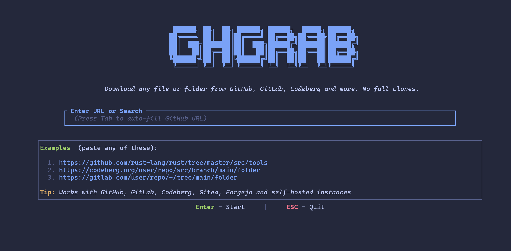

## 1. What are Git, GitHub, and GitLab?

- **Git** is a version control system. It records changes to files so you can track your work and collaborate.
- **GitHub** and **GitLab** are platforms that host Git repositories online.
- A **repository (repo)** is a project folder with its version history.
- A **commit** is a saved snapshot of changes.
- **Local** means on your computer; **remote** means on a server such as GitHub or GitLab.
- **Cloning** means making a local copy of a remote repository, including its history.

## 2. Install and configure Git (once)

1. Install Git from <https://git-scm.com/downloads>.
2. Create an account on <https://github.com> or your university GitLab server.
3. Open a terminal (Git Bash or PowerShell on Windows; Terminal on macOS/Linux).
4. Check Git is installed:

```bash
git --version
```

Set the name and email that will appear on your commits:

```bash
git config --global user.name "Your Name"
git config --global user.email "you@example.com"
```

Set a new local name and email for, e.g., GitLab:

```bash
cd your-folder-path 

git config --local user.name "Max Mustermann"
git config --local user.email "student@uni-mainz.de"
```

::: {.callout-note}
These settings identify your commits. They **do not** sign you in to GitHub or GitLab.
:::

## 3. Create a repository on GitHub or GitLab

1. Sign in to GitHub or GitLab.
2. On **GitHub**, choose **New repository**. On **GitLab**, choose **New project → Create blank project**.
3. Enter a name such as `intro-to-git`.
4. Choose **Public** or **Private**.
5. For this exercise, initialize the repository with a **README**.
6. Create the repository, then copy its **HTTPS clone URL** using the **Code** (GitHub) or **Clone** (GitLab) menu.

An example GitHub URL looks like this:

```text
https://github.com/USERNAME/intro-to-git.git
```

GitLab works the same way, but uses the URL of your GitLab server.

## 4. Clone the repository to your computer

Open a terminal and go to the directory where you want to keep your projects:

```bash
cd path/to/your/projects
```

Clone the repo (replace the example URL with your own):

```bash
git clone https://github.com/USERNAME/intro-to-git.git
cd intro-to-git
git status
```

`git clone` creates a folder with the project files and Git history. It also connects the local repository to the remote, usually named `origin`.

## 5. Edit, commit, and push changes

Open `README.md` in a text editor and add a sentence. Save the file, then run:

```bash
git status
git add README.md
git commit -m "Update README"
git push
```

- `git status` shows which files have changed.
- `git add` selects changes for the next commit (**staging**).
- `git commit` records the changes in your **local** repository.
- `git push` uploads your local commits to GitHub or GitLab.

Refresh the repository page in your browser to see the updated README.

To bring in changes that are on the server but not yet on your computer:

```bash
git pull
```

## 6. Alternative: publish an existing local folder

If you already have a project on your computer, first create an **empty** repository on GitHub or GitLab (do **not** initialize it with a README). Then open a terminal inside your existing project folder:

```bash
cd path/to/my-project
git init
git add .
git commit -m "Initial commit"
git branch -M main
git remote add origin https://github.com/USERNAME/my-project.git
git push -u origin main
```

Replace the URL with the URL of your **empty** remote repository. The `-u` option sets up tracking, so later you can simply type `git push`.

::: {.callout-warning}
Do not commit passwords, access tokens, or other sensitive information. Use a `.gitignore` file to exclude temporary, generated, or sensitive local files before staging them.
:::

## 7. Everyday Git commands

| Command | Purpose |
|---|---|
| `git clone URL` | Copy a remote repository to your computer |
| `git status` | Check file changes |
| `git add FILE` | Stage a specific file |
| `git add .` | Stage changes in the current directory and below |
| `git commit -m "message"` | Save a local snapshot |
| `git push` | Upload commits to the remote |
| `git pull` | Download and integrate remote changes |
| `git log --oneline` | Show recent commits |

## 8. Classroom exercise (5–10 minutes)

1. Create a repository on GitHub or GitLab with a README.
2. Copy its HTTPS URL and clone it to your computer.
3. Edit `README.md` and save it.
4. Run `git status`, `git add README.md`, `git commit -m "My first change"`, and `git push`.
5. Refresh the webpage and check that your change appears.

::: {.callout-tip}
You can usually clone a **public** repository without signing in. Pushing changes—or cloning a **private** repository—requires authentication. Depending on the setup, this may use a browser sign-in, a credential manager, an SSH key, or an access token. Do not paste your account password into Git.
:::

## 9. Excourse: ghgrab ##

First Steps:
```bash
python --version
winget install --id Python.Python.3.14 -e
py -3.14 -m ensurepip --upgrade
python -m pip install --user pipx
python -m pipx ensurepath
```

Close and reopen the terminal:
```bash
pipx install ghgrab
ghgrab --help
```

{height=300px fig-align="center"}